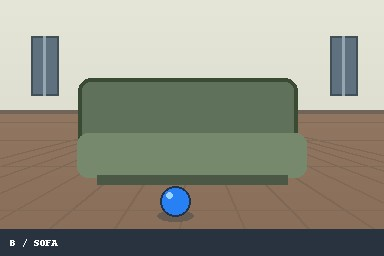

# 小狗的视觉记忆与世界模型

小狗刚在沙发旁看见蓝球，转身回到大厅。如果有人在它背后把球搬走，它还会去哪里找？

我们在 Jetson AGX Orin 上，用同一个冻结的 Qwen3-VL-8B 在三个地点找球。记录每个地点最近一次观察时，小狗亲眼看到球换位置的 **211 局全部首选正确**。球从背后被搬走时，出发前的画面和球留在原处时逐帧相同。它 **211 局都先去旧位置**，随后有 **130 局在三步内找回**。

| 想看什么 | 入口 |
| --- | --- |
| 看一局小狗怎样记对、忘记，又怎样找回来 | [实验报告与图例](docs/实验报告.md) |
| 自己看图猜下一步，或复算所有正式成绩 | [观察练习、原始回答与复核脚本](data/README.md) |
| 了解下一轮怎样训练小狗预测“叼起”和“等待”的不同后果 | [13 小时训练计划 · 待执行](docs/13小时训练计划.md) |

本轮完成 **844 个模拟回合、4,431 条策略轨迹**。三处都查一遍也能找到球，报告分别列出首选正确率和三步找回率。
