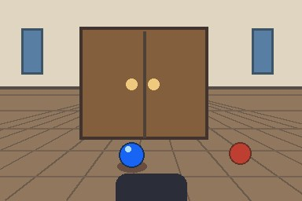
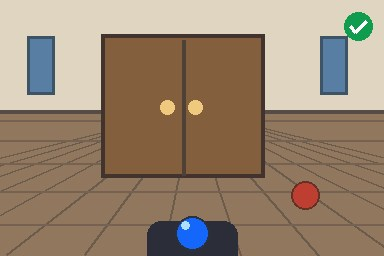
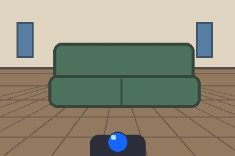

# 小狗学会了预测叼球，送球还有几步要练

2026 年 11 月 19 日，Jetson AGX Orin 完成了新一轮动作预测。预检、读图、训练、评测和设备归档共 **2 小时 17 分**。六组模型各训练 20 轮，共 **23,040 次 CUDA 更新**。每个 GRU 预测器有 21,703 个参数。[训练计划](13小时训练计划.md) · [实测原始数据与复算](../data/动作预测实测/)

## 同一只球，小狗有两个选择

这是第 5000 号封存布局里的同一张起始画面。小狗可以等一等，也可以叼球。两次从相同的画面和观察历史开始。下面是执行动作后的实际模拟画面。

| 同一个起点 | 等一下 | 叼起来 |
| --- | --- | --- |
|  |  |  |

同分布外观的 128 个封存布局里，“叼起／等待”和“放下／等待”各有一对，两种动作后地面与嘴边状态都要判对。三种子合计，**告诉它动作时对了 749/768 对（97.5%），遮掉动作时对了 0/768 对**。以布局配对，提升 97.5 个百分点，95% 区间为 95.6 至 99.2 个百分点。连续推演五步时，含动作组的地面蓝球准确率是 92.8%，持球是 96.5%。[逐组预测指标](../data/动作预测实测/metrics.json)

## 能猜对下一步，也要记得把球放下

| 送球方式 | 成功次数 |
| --- | ---: |
| 先推演候选路线再行动 | 301/384（78.4%） |
| 按最近看到球的位置走 | 372/384（96.9%） |
| 按固定顺序找球 | 372/384（96.9%） |
| 打乱路线预测得分 | 3/384（0.8%） |

384 局是同一批 128 个布局在三个模型种子下的合计。推演组的 83 次失败里，有 63 次到结束还叼着球。下面的第 5003 号布局就是一例。小狗已经到目标 B，球还在嘴里，轮到它做的动作是放下。

当球在看不见的地方被挪动时，相同的历史可以对应不同结果。测试规定球有 50% 的机会仍在 B，小狗给“查 B 能看到球”的平均概率只有 3.9%。在 B 处，模型的 Brier 分数约 0.465，固定报 50% 的分数为 0.250，越低越好。[封存分叉与闭环记录](../data/动作预测实测/evaluation/)

## 开跑前解决的两个问题

- **让模型答能执行的动作。** 在上一轮的 72 个固定问题上，只限答 A、B、C，首答命中从 23/72 上升到 64/72。原先答大厅 H 的 49 道里有 41 道改为正确地点。[逐问原始记录](../data/动作预测实测/interface.jsonl)
- **测用一路还是两路读图。** 初版整图提示漏掉了调试图里的地上和嘴边蓝球。冻结前改为分别看家具裁图和蓝球区域，成功与失败反馈从截图里的红绿图标取值。用同一批 48 张图，从单路、双路、双路、单路各跑一遍。四轮逐图解析一致，单路 0.711 帧/秒，双路 0.817 帧/秒，总吞吐提高 14.9%。本轮读图采用双路。[吞吐与逐图回答](../data/动作预测实测/verified-throughput-progress.json)

训练、验证和封存测试分别有 256、64 和 128 个布局。测试另有 32 个布局换了外观。跨划分的完整轨迹无重叠，训练和测试间有 278 张字节相同的图像，这些图复用了冻结 VLM 读数。实验发生在程序生成的离散房间，闭环结果按该环境的送球规则计算。[数据划分审计](../data/动作预测实测/split-audit.json)
