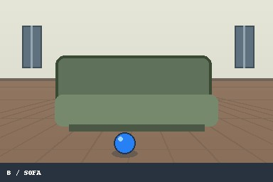
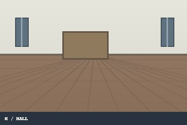
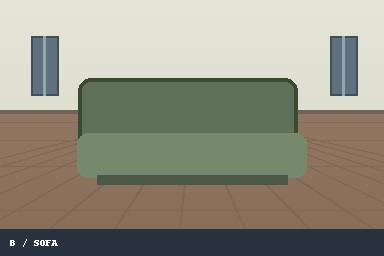
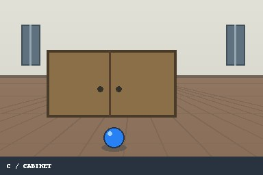

# 小狗记得球在哪，也能预测下一步吗？

本轮用冻结的 Qwen3-VL-8B-Instruct 在 Jetson AGX Orin 上找蓝球。房间由程序绘制，狗可以检查桌子 A、沙发 B、柜子 C，各局最多三次。它先看 12 帧，再在大厅 H 作第一次选择。2026 年 11 月 17 日晚至 18 日凌晨，211 个正式布局全部完成，共 844 个回合、4,431 条策略轨迹和 23,004 次正式调用。8 小时 38 分 36 秒是包含启动、恢复与试跑的墙钟时间。

**从这里进入**　[13 小时后续训练计划](13小时训练计划.md) · [1,668 条下一步观察练习](../data/下一步观察练习/) · [全量正式回答与复算](../data/视觉记忆复算包/)

## 一局看懂“记得”和“猜到”的区别

第 1000 号布局。小狗最后在沙发 B 看见蓝球，之后看过桌子、柜子，回到大厅。下面是实际送入模型的画面。

| t6 · 沙发上有球 | t11 · 回到大厅 |
| --- | --- |
|  |  |

做两次回放。第一次，球留在 B。第二次，球趁小狗背对它时从 B 移到 C。出发前的全部 12 帧逐帧相同，两次给“按地点记录”策略的证据也相同。它都先查 B；第二次扑空后，又查了 A，最后去 C 找到球。

| 执行“检查 B”后，第二次回放看到什么？ | 随后检查 C |
| --- | --- |
|  |  |

在同一布局的原处回合，逐步摘要起初还记得球在 B。读到第 9 帧的空大厅时，它把“最后看到球的地点”改成了 H。之后连续查 A 三次。这条错误可以定位到一次具体的记忆写入。[四个回合的完整图文案例，下载后可离线打开](../data/视觉记忆复算包/01_我要看的内容/小狗找球_四局案例.html)

## 所有布局的表现

下表按布局计数，每列分母均为 211。最后一列要求同一布局的两段历史指向不同球位，且两边第一次都选对；两边的当前画面相同。

| 策略 | 球留原地，首选正确 | 目睹换位，首选正确 | 背后换位，首选正确 | 背后换位，三步内找回 | 反事实两边首选都对 |
| --- | ---: | ---: | ---: | ---: | ---: |
| 各地点最近观察 | 211 | 211 | 0 | 130 | 208 |
| 每步重写文字摘要 | 148 | 153 | 20 | 96 | 98 |
| 完整观察文本 | 29 | 73 | 0 | 4 | 9 |
| 当前画面及本局已查反馈 | 77 | 64 | 64 | 211 | 未安排 |

完整历史策略有 **680 次回答 H**。H 是当前位置，程序只接受 A/B/C；遇到非法回答即结束该局。在“原处”的 211 次首答中，182 次答 H，其余 29 次全选对。完整历史的低分同时反映了动作接口的影响。另一方面，三个地点各检查一次就能覆盖整个房间，三步成功也可能来自按顺序寻找。[含最近帧和关键帧在内的全部 21 组结果](../data/视觉记忆复算包/01_我要看的内容/分条件实测.csv)

把四种情境等权、按布局配对，逐步摘要使每局的决策峰值输入平均少约 54 个 token。连同写摘要的成本一起算，却平均多用约 2,283 个 token 和 22.1 秒。共享读图开销单列；两种策略的提前终止率也不同。这个对照借鉴了 NVIDIA 的单步上下文压缩方法，测试的是短观察序列中的成本与错误。[You don't need long context](https://arxiv.org/abs/2611.05306)

## 下一轮要学哪件事

这轮记录了小狗实际选了什么，以及检查以后看见什么。下一轮会在它行动**之前**另外记录预测。例如，同样看见沙发上的球，如果等一下，地上还有球；如果成功把球叼起，下一眼应是地上空、嘴里有球。先用含动作和遮掉候选动作的两个小网络比较，再检验预测能否帮助把球送到目标位置。此次上传的是上一轮实测数据和新一轮拟执行的协议。[13 小时的阶段、训练目标与验收](13小时训练计划.md)
